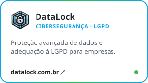
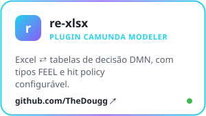
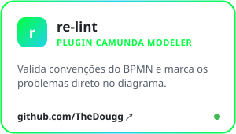
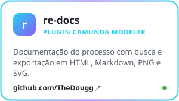
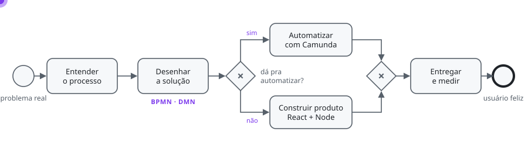

  
  
  
  

### 🧭 Quem está aí? · who's there?

<b>👔 Sou recrutador(a)</b> — o resumo em 20 segundos

 

- Dev **full stack** em **TypeScript**: React + Vite + Tailwind no front, Node.js (Express/Fastify) + Prisma + Zod no back.
- Coloco produto no ar do zero: **SimulAI Academy** (edtech com IA), **DataLock** (cibersegurança/LGPD) e **Dividiu** (rateio com Pix).
- **Segurança de dados** desde o código: hash Argon2/bcrypt, 2FA + JWT, monitoramento de vazamentos, rate limit e validação com Zod.
- Automação de processos com **Camunda** (BPMN/DMN), mais **Python** e **Java** no dia a dia.
- Mantenho 3 plugins open source para o Camunda Modeler. Contato no [LinkedIn](https://www.linkedin.com/in/douglas-henrique-04671a215/).

<b>🧑‍💻 Sou dev</b> — me mostra código

 

Os plugins do Camunda Modeler são abertos: [re-xlsx](https://github.com/TheDougg/camunda-modeler-re-xlsx), [re-lint](https://github.com/TheDougg/camunda-modeler-re-lint) e [re-docs](https://github.com/TheDougg/camunda-modeler-re-docs). Issue e PR são bem-vindos.

E este perfil também é código: o jogo da velha lá embaixo roda em GitHub Actions com um bot minimax em JavaScript ([`velha/jogo.mjs`](velha/jogo.mjs)) e um Worker da Cloudflare que grava a jogada no clique ([`worker/`](worker/src/index.mjs)), e as animações são SVG puro gerado por [`scripts/gen_svgs.py`](scripts/gen_svgs.py).

<b>🤝 Tenho um projeto ou uma parceria</b> — vamos conversar

 

Gosto de problema de negócio de verdade: processo manual que dá pra automatizar, ideia que precisa virar produto, escola que quer usar IA sem perder o pedagógico. Me chama no [LinkedIn](https://www.linkedin.com/in/douglas-henrique-04671a215/) ou por [e-mail](mailto:douglas123@live.com.pt).

<b>🇺🇸 English version</b>

 

Hi, I'm **Douglas (Doug)**, a full stack developer from Brazil. I build products end to end in **TypeScript** (React, Vite, Tailwind, Node.js, Prisma), care a lot about **data security** (Argon2/bcrypt hashing, 2FA + JWT, breach monitoring, LGPD), automate business processes with **Camunda** (BPMN/DMN), and use **Python** and **Java** where they fit.

What I've shipped:
- **[SimulAI Academy](https://simulaiacademy.com)**: study with AI, not against it. Upload a PDF and get practice exams, mind maps and essay grading.
- **[DataLock](https://datalock.com.br)**: data protection and privacy compliance (LGPD) for companies.
- **[Dividiu](https://dividiu.app)**: split the bill with your group and collect via Pix.
- **Camunda Modeler plugins** (open source): Excel ⇄ DMN, BPMN linting and process documentation export.

Scroll down and play tic-tac-toe against my bot. Every move is a GitHub issue.

 

## 🚀 Produtos que construí

  <a href="https://simulaiacademy.com"><picture><source media="(prefers-color-scheme: dark)" srcset="assets/cards/simulai-dark.svg"></picture></a>
  <a href="https://datalock.com.br"><picture><source media="(prefers-color-scheme: dark)" srcset="assets/cards/datalock-dark.svg"></picture></a>
  <a href="https://dividiu.app"><picture><source media="(prefers-color-scheme: dark)" srcset="assets/cards/dividiu-dark.svg"></picture></a>

## 🛡️ Segurança de dados

O que está de pé nos meus produtos hoje, puxado direto do código. · <i>What actually runs in my products today.</i>

## 🧩 Open source · plugins para o Camunda Modeler

  <a href="https://github.com/TheDougg/camunda-modeler-re-xlsx"><picture><source media="(prefers-color-scheme: dark)" srcset="assets/cards/re-xlsx-dark.svg"></picture></a>
  <a href="https://github.com/TheDougg/camunda-modeler-re-lint"><picture><source media="(prefers-color-scheme: dark)" srcset="assets/cards/re-lint-dark.svg"></picture></a>
  <a href="https://github.com/TheDougg/camunda-modeler-re-docs"><picture><source media="(prefers-color-scheme: dark)" srcset="assets/cards/re-docs-dark.svg"></picture></a>

## 🔄 Como eu trabalho · em BPMN, claro

<picture>
  <source media="(prefers-color-scheme: dark)" srcset="assets/fluxo-dark.svg">
  
</picture>

O pontinho é um token percorrendo o processo, igual no Camunda Cockpit.

## 🎮 Jogue comigo: jogo da velha contra meu bot

<!-- VELHA:INICIO -->

<b>Você é ❌. Clique numa casa vazia</b> e pronto: o bot responde ⭕ e o tabuleiro atualiza na hora. 
O bot joga perfeito (minimax): o melhor que dá pra tirar dele é empate. · <i>You're ❌. Click a square; the bot plays perfectly.</i>

<table align="center"><tr><td></td><td></td><td></td></tr><tr><td></td><td></td><td></td></tr><tr><td></td><td></td><td></td></tr></table>

Último jogo: deu velha 🤝

<table align="center"><tr><td></td><td></td><td></td></tr><tr><td></td><td></td><td></td></tr><tr><td></td><td></td><td></td></tr></table>

🏅 Jogar com meu @ (entra no ranking) · últimas jogadas

Pelo clique a jogada é anônima. Para aparecer no ranking, jogue por uma issue escolhendo a casa: [1](https://github.com/TheDougg/TheDougg/issues/new?title=velha%7C1&body=S%C3%B3%20clicar%20em%20**Create**%20%F0%9F%91%87%20%E2%80%94%20o%20bot%20joga%20em%20uns%2020%20segundos%20e%20atualiza%20o%20README.%0A%0AJust%20hit%20**Create**%20%E2%80%94%20the%20bot%20moves%20in%20~20s%20and%20updates%20the%20README.) · [2](https://github.com/TheDougg/TheDougg/issues/new?title=velha%7C2&body=S%C3%B3%20clicar%20em%20**Create**%20%F0%9F%91%87%20%E2%80%94%20o%20bot%20joga%20em%20uns%2020%20segundos%20e%20atualiza%20o%20README.%0A%0AJust%20hit%20**Create**%20%E2%80%94%20the%20bot%20moves%20in%20~20s%20and%20updates%20the%20README.) · [4](https://github.com/TheDougg/TheDougg/issues/new?title=velha%7C4&body=S%C3%B3%20clicar%20em%20**Create**%20%F0%9F%91%87%20%E2%80%94%20o%20bot%20joga%20em%20uns%2020%20segundos%20e%20atualiza%20o%20README.%0A%0AJust%20hit%20**Create**%20%E2%80%94%20the%20bot%20moves%20in%20~20s%20and%20updates%20the%20README.) · [6](https://github.com/TheDougg/TheDougg/issues/new?title=velha%7C6&body=S%C3%B3%20clicar%20em%20**Create**%20%F0%9F%91%87%20%E2%80%94%20o%20bot%20joga%20em%20uns%2020%20segundos%20e%20atualiza%20o%20README.%0A%0AJust%20hit%20**Create**%20%E2%80%94%20the%20bot%20moves%20in%20~20s%20and%20updates%20the%20README.) · [7](https://github.com/TheDougg/TheDougg/issues/new?title=velha%7C7&body=S%C3%B3%20clicar%20em%20**Create**%20%F0%9F%91%87%20%E2%80%94%20o%20bot%20joga%20em%20uns%2020%20segundos%20e%20atualiza%20o%20README.%0A%0AJust%20hit%20**Create**%20%E2%80%94%20the%20bot%20moves%20in%20~20s%20and%20updates%20the%20README.) · [8](https://github.com/TheDougg/TheDougg/issues/new?title=velha%7C8&body=S%C3%B3%20clicar%20em%20**Create**%20%F0%9F%91%87%20%E2%80%94%20o%20bot%20joga%20em%20uns%2020%20segundos%20e%20atualiza%20o%20README.%0A%0AJust%20hit%20**Create**%20%E2%80%94%20the%20bot%20moves%20in%20~20s%20and%20updates%20the%20README.) · [9](https://github.com/TheDougg/TheDougg/issues/new?title=velha%7C9&body=S%C3%B3%20clicar%20em%20**Create**%20%F0%9F%91%87%20%E2%80%94%20o%20bot%20joga%20em%20uns%2020%20segundos%20e%20atualiza%20o%20README.%0A%0AJust%20hit%20**Create**%20%E2%80%94%20the%20bot%20moves%20in%20~20s%20and%20updates%20the%20README.)

**Top jogadores:** [@SergioS0ares](https://github.com/SergioS0ares) (9) · [@TheDougg](https://github.com/TheDougg) (4)

- 22/10 12:14 — alguém ❌ casa 5 · bot ⭕ casa 3
- 22/10 15:01 — @SergioS0ares ❌ casa 6
- 22/10 15:01 — @SergioS0ares ❌ casa 7 · bot ⭕ casa 4
- 22/10 15:00 — @SergioS0ares ❌ casa 2 · bot ⭕ casa 3
- 22/10 14:59 — @SergioS0ares ❌ casa 9 · bot ⭕ casa 8

14 jogadas no total.

<!-- VELHA:FIM -->

## 🛠 Stack

   
   
  

## 📈 Atividade

  

<picture>
  <source media="(prefers-color-scheme: dark)" srcset="https://raw.githubusercontent.com/TheDougg/TheDougg/output/snake-dark.svg">
  
</picture>

